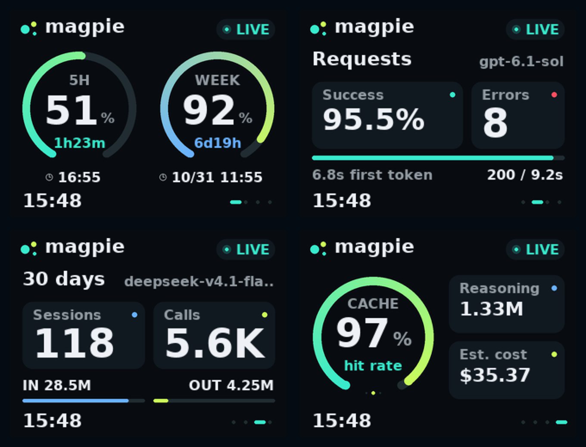
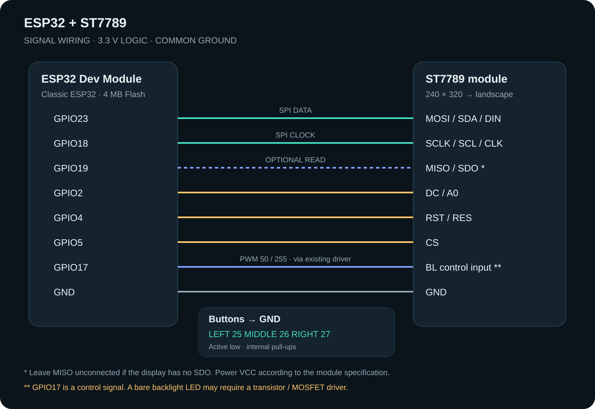
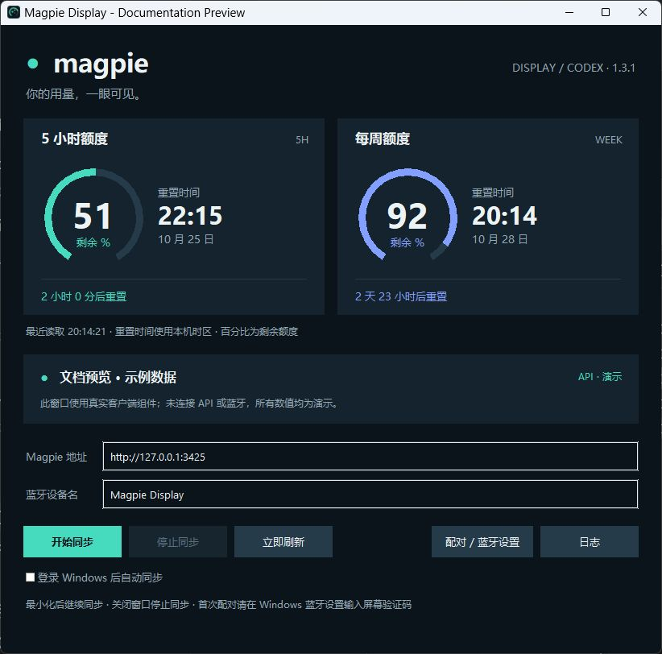

# Magpie Display · ESP32 quota dashboard

[简体中文](README.md) · [Releases](https://github.com/Sukkk-zcy/codex-usage-display/releases)

A Windows companion and classic ESP32/ST7789 dashboard for Codex **5-hour and weekly remaining quotas**, powered by the local Magpie Agent API. No ESP32-S3, PSRAM or Wi-Fi is required.



These are host-rendered layout previews using the firmware's glyphs, not device photographs. The Windows screenshot below uses the actual client widgets with synthetic data and no API/BLE connection.

This is a fork of [jayyao97/codex-usage-display](https://github.com/jayyao97/codex-usage-display), incorporating the Magpie adapter from [peterroe/magpie-usage-display](https://github.com/peterroe/magpie-usage-display). See [provenance and licenses](THIRD_PARTY_NOTICES.md). The original targets Waveshare ESP32-S3 AMOLED/macOS; this branch targets classic ESP32, ST7789 and Windows.

## Hardware

Classic ESP32 Dev Module, 4 MB Flash, ST7789 240×320 SPI display (320×240 landscape), three active-low buttons and a Windows 10/11 x64 PC with BLE. See [wiring and electrical notes](docs/HARDWARE.md).



| Signal | GPIO |
| --- | --- |
| MOSI / SCLK / MISO (optional) | 23 / 18 / 19 |
| DC / RST / CS | 2 / 4 / 5 |
| Backlight control input | 17 |
| Left / middle / right buttons to GND | 25 / 26 / 27 |

Use 3.3 V logic and the supply voltage required by your display module. GPIO17 controls an existing backlight driver; do not power a high-current bare LED directly from a GPIO. ESP32-S2 lacks BLE; C3/S3 are not configured targets.

## Build and flash

With Git and Python 3.11 installed, run in PowerShell:

```powershell
git clone https://github.com/Sukkk-zcy/codex-usage-display.git
cd codex-usage-display
python -m pip install platformio==6.2.0
python -m platformio run -e magpie-esp32
python -m platformio device list
python -m platformio run -e magpie-esp32 -t upload --upload-port COM5
```

Replace COM5 with the USB serial port. PlatformIO Upload writes the bootloader, partitions and application at their correct offsets. `firmware.bin` alone is not a complete image for address zero. Firmware uses Espressif32 6.10.0 / Arduino-ESP32 2.0.17 with a no-OTA partition.

## Windows companion

1. Run [Magpie](https://github.com/yetone/magpie) ([official downloads](https://github.com/yetone/magpie-releases/releases)) with its local API enabled, normally `http://127.0.0.1:3425`. This repository does not ship the Agent. Required endpoints are documented in [DATA.md](docs/DATA.md).
2. Pair **Magpie Display** in Windows Bluetooth Settings. Enter the random six-digit code shown on the ESP32. Pair through Windows before starting synchronization.
3. Download and extract the Windows package from [Releases](https://github.com/Sukkk-zcy/codex-usage-display/releases), run `MagpieDisplay.exe`, then click **开始同步** (Start sync). Python is not needed for the EXE.
4. **停止同步** stops synchronization; **立即刷新** refreshes; **日志** opens logs. Minimize to keep running; closing the window stops synchronization. Optional sign-in startup is disabled by default.



To build the EXE yourself:

```powershell
powershell -NoProfile -ExecutionPolicy Bypass -File .\companion\build_desktop.ps1
.\dist\MagpieDisplay.exe
```

The GUI is currently in Chinese. [Windows documentation](docs/WINDOWS.md) covers pairing, recovery, logs, startup and the CLI. Logs/settings default to `%LOCALAPPDATA%\MagpieUsageDisplay\`; the log button resolves redirected paths.

## Pages and controls

The home page shows only Codex's 300-minute and 10080-minute quota windows. Missing quota is `--`, not 100%. Reset timestamps use the PC's time zone; an elapsed reset shows `DUE` until the API confirms new data. The other pages show requests, 30-day sessions and cache/reasoning/cost statistics. “Context” is an API aggregate, not the active chat's context-window occupancy.

| Button | Action |
| --- | --- |
| Left / right short press | Previous / next page |
| Middle short press | Refresh |
| Middle hold 1 second | Focus the already-running Magpie Agent |
| Right hold 1 second | Toggle display; BLE continues |
| Left hold 3 seconds | Clear bonds and restart; pair again in Windows |

The first short press on a sleeping display only wakes it. `OFFLINE` means disconnected, `LINKING` means waiting for this connection's first snapshot, and `STALE` means no valid snapshot for 60 seconds.

## Tests and limits

```powershell
python -m venv companion/.venv
.\companion\.venv\Scripts\python.exe -m pip install -r companion/requirements.txt
.\companion\.venv\Scripts\python.exe -m unittest discover -s companion/tests -v
python -m platformio run -e magpie-esp32
```

All 57 companion tests pass and the standalone firmware builds. The final animated firmware has not been flashed during publication preparation; full power-cycle recovery in desktop 1.3.1 still needs additional hardware verification. See [validation scope](docs/VALIDATION.md), [BLE protocol](docs/BLE_PROTOCOL.md) and [contribution guide](CONTRIBUTING.md).

Project code is [MIT licensed](LICENSE); bundled libraries and fonts retain their [own licenses](THIRD_PARTY_NOTICES.md). Original AMOLED/macOS code remains available upstream and in Git history. Personal images, greeting-card experiments and the unrelated legacy weather clock are outside this distribution. This project is not affiliated with OpenAI.
