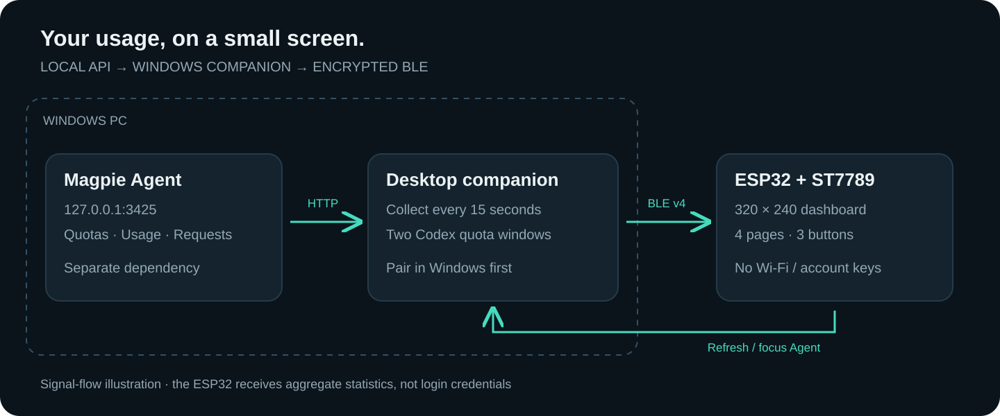
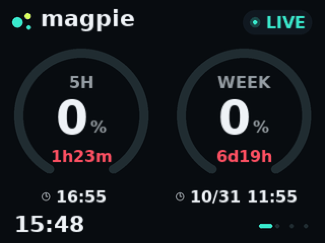

# Magpie Display · ESP32 额度显示器

[English](README.en.md) · [快速开始](#快速开始) · [接线](docs/HARDWARE.md) · [Windows 使用指南](docs/WINDOWS.md) · [下载](https://github.com/Sukkk-zcy/codex-usage-display/releases)

把 Codex 的 **5 小时 / 每周剩余额度**放到桌面小屏上。普通 ESP32、ST7789 和 Windows 电脑即可运行，不需要 ESP32-S3、PSRAM 或 Wi-Fi。


*上图为使用固件相同字体生成的布局预览，全部为示例数据，不是实机照片。*

这是 [jayyao97/codex-usage-display](https://github.com/jayyao97/codex-usage-display) 的 fork，结合 [peterroe/magpie-usage-display](https://github.com/peterroe/magpie-usage-display) 的 Magpie 数据适配进行移植。感谢 Jay Yao 和 peterroe 的开源工作。来源版本、改动范围和许可证见 [来源与第三方声明](THIRD_PARTY_NOTICES.md)。

## 这个版本有什么

- 双额度圆环：剩余百分比、重置倒计时、实际重置时刻；低额度变色。
- 四个页面：额度、今日请求、30 天会话汇总、缓存与推理统计。
- Windows 桌面客户端：开始 / 停止 / 立即刷新、API 与蓝牙状态、日志入口、可选登录自动同步。
- 六位验证码配对和加密 BLE；设备断线后自动重连。
- 三个实体按键：翻页、刷新、唤起 Magpie、熄屏、清除绑定。
- 抗锯齿字体、额度缓动与切页动画；复用 76,800 字节显示缓冲。

| | 上游原版 | 当前 fork |
| --- | --- | --- |
| 硬件 | Waveshare ESP32-S3 AMOLED 2.16 | ESP32 Dev Module + ST7789 240×320 |
| 显示 | 480×480、LVGL、触摸 | 横屏 320×240、TFT_eSPI、三个按键 |
| 电脑端 | macOS Companion | Windows 10/11 桌面客户端与 CLI |
| 数据来源 | Codex app-server / Hook | Magpie Agent 本地 API |
| 主要展示 | 账户用量与运行任务 | Codex 双窗口额度与 Magpie 统计 |

## 工作原理



电脑端每 15 秒读取 Magpie 的本地接口，再通过 BLE 发送紧凑统计数据。ESP32 不保存账户凭据，也不连接互联网。请先安装并运行 [Magpie](https://github.com/yetone/magpie)（[官方下载](https://github.com/yetone/magpie-releases/releases)），它提供 `/v1/magpie/quotas`、`/v1/magpie/usage` 等接口；本仓库只提供显示器固件和配套客户端。API 契约见 [数据说明](docs/DATA.md)。

## 快速开始

### 1. 准备硬件

需要带 BLE 的**经典 ESP32**开发板（4 MB Flash）、ST7789 SPI 屏幕、三个按键、USB 数据线，以及 Windows BLE 适配器。ESP32-S2 没有 BLE；ESP32-C3/S3 不能直接套用本工程的引脚和构建配置。

屏幕竖向分辨率为 240×320，固件横向使用 320×240。按 [硬件接线图](docs/HARDWARE.md) 连接；屏幕供电、背光驱动要根据具体模块确认。已有同样接线的时钟硬件可以复用。

### 2. 编译并烧录

安装 Git、Python 3.11 和 PlatformIO Core，打开 PowerShell：

```powershell
git clone https://github.com/Sukkk-zcy/codex-usage-display.git
cd codex-usage-display
python -m pip install platformio==6.2.0
python -m platformio run -e magpie-esp32
python -m platformio device list
python -m platformio run -e magpie-esp32 -t upload --upload-port COM5
```

把 `COM5` 换成 USB 串口，不要选择蓝牙串口。也可在 VS Code PlatformIO 中打开仓库根目录并执行 Build / Upload。首次烧录使用 PlatformIO Upload，它会写入 bootloader、分区表及应用；不要把单独的 `firmware.bin` 当作完整 Flash 镜像写到地址 0。

### 3. 启动 Windows 客户端

从 [Releases](https://github.com/Sukkk-zcy/codex-usage-display/releases) 下载 Windows 压缩包，完整解压后运行 `MagpieDisplay.exe`，无需安装 Python。保持 EXE 及许可文件在固定目录。

1. 启动 Magpie Agent，启用本地 API，默认地址为 `http://127.0.0.1:3425`。
2. 在 Windows **设置 → 蓝牙和设备 → 添加设备**中选择 **Magpie Display**，输入小屏上的六位验证码。
3. 打开客户端，确认 API 地址，点击 **开始同步**。
4. 需要暂停时点击 **停止同步**；最小化继续运行，关闭窗口停止同步。


*客户端截图来自离线文档预览，使用示例数据，未连接真实账户或设备。*

需要自行构建 EXE：

```powershell
powershell -NoProfile -ExecutionPolicy Bypass -File .\companion\build_desktop.ps1
.\dist\MagpieDisplay.exe
```

完整配对、开机启动、日志和重连说明见 [Windows 使用指南](docs/WINDOWS.md)。

## 界面与按键



*动画为主机布局预览；实际色彩与帧率受屏幕、SPI 和绘制耗时影响。*

| 页面 | 含义 |
| --- | --- |
| 额度 | 左侧 Codex 5 小时、右侧每周；大数字与圆环都表示**剩余**百分比 |
| 请求 | 今日成功率、错误数、首 token 等待、最近请求响应 |
| 会话 | Magpie 返回的 30 天汇总、主要模型、输入 / 输出比例 |
| 上下文 | 缓存命中率、推理 tokens、估算费用；不是当前聊天的上下文占用率 |

未知额度显示 `--`，不会当作满额；到达重置时间显示 `DUE`，等待接口确认，设备不会自行补满。时间采用电脑本机时区。

| 按键 | 操作 |
| --- | --- |
| 左 / 右短按 | 上一页 / 下一页 |
| 中短按 | 请求立即刷新 |
| 中长按 1 秒 | 将已运行的 Magpie Agent 窗口带到前台 |
| 右长按 1 秒 | 熄屏 / 亮屏；蓝牙继续同步 |
| 左长按 3 秒 | 清除蓝牙绑定并重启，之后需要重新配对 |

熄屏后的首次短按只唤醒。`OFFLINE` 表示蓝牙未连接，`LINKING` 表示等待本次连接首包，`STALE` 表示最近 60 秒没有有效快照。更多边界状态见 [数据说明](docs/DATA.md)。

## 开发与验证

```powershell
python -m venv companion/.venv
.\companion\.venv\Scripts\python.exe -m pip install -r companion/requirements.txt
.\companion\.venv\Scripts\python.exe -m unittest discover -s companion/tests -v
.\companion\.venv\Scripts\python.exe -m companion.codex_display --once
python -m platformio run -e magpie-esp32
```

`--once` 会读取你本机的 Magpie 统计并输出 JSON，不连接蓝牙。不要直接把包含个人统计的输出贴到公开 Issue。

```text
src/magpie/                 固件、BLE、界面与灰度字体
lib/                        三个随源码提供的 Arduino 库及屏幕配置
companion/codex_display/     Windows GUI、CLI、API 与 BLE 适配
companion/tests/             自动化回归测试
tools/                      字体生成、离线预览、文档检查
preview/magpie_dashboard/    示例界面与动画
docs/                       接线、使用指南、数据说明与 BLE 协议
```

发布验证与已知限制见 [验证记录](docs/VALIDATION.md)，参与修改见 [CONTRIBUTING.md](CONTRIBUTING.md)。原 macOS/AMOLED 实现保留在 [上游仓库](https://github.com/jayyao97/codex-usage-display) 和本 fork 的 Git 历史中；当前默认分支只构建本移植版。原天气时钟、个人图片和贺卡实验不属于这次公开发行内容。

## 许可证

项目代码使用 [MIT License](LICENSE)，保留上游版权声明。字体与随附库分别遵循 [第三方声明](THIRD_PARTY_NOTICES.md) 中的许可证。本项目与 OpenAI 无隶属关系；Magpie Agent 是独立依赖。
