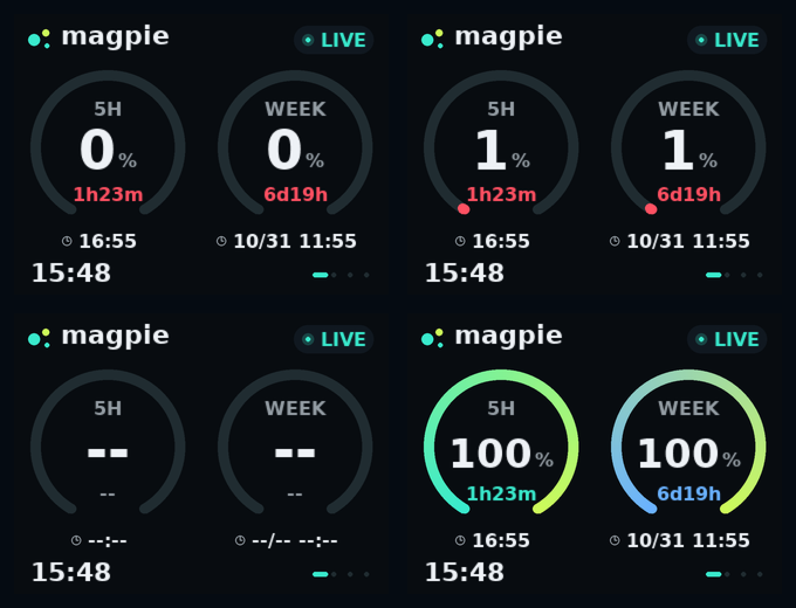
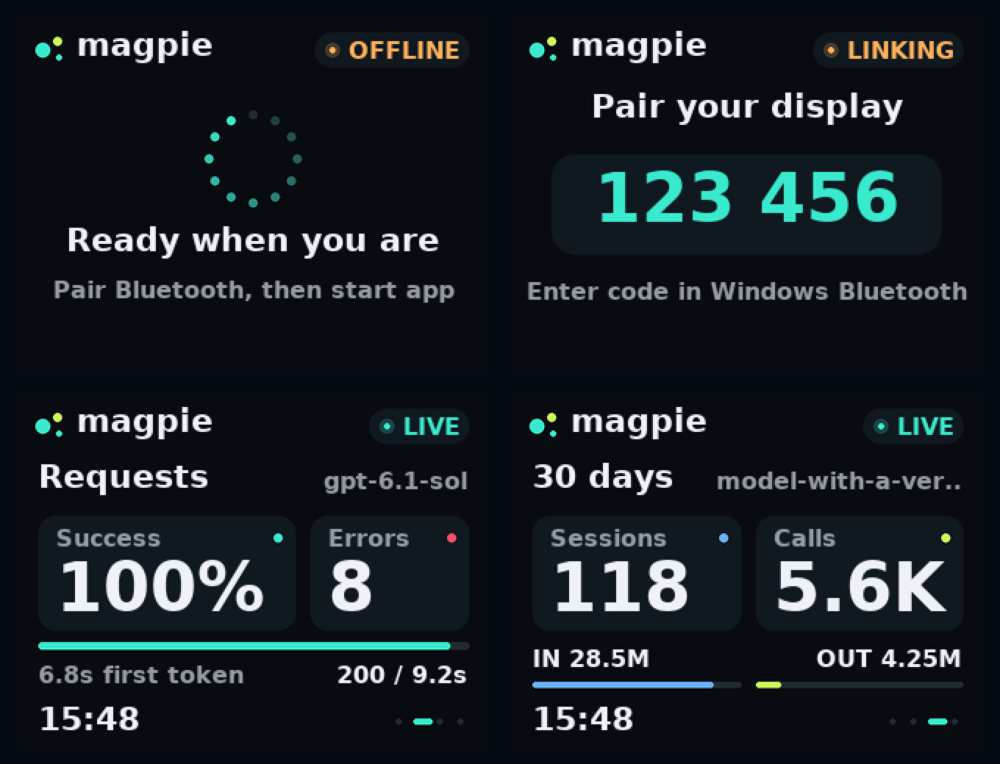

# 数据来源与显示口径

[返回首页](../README.md) · [BLE 协议](BLE_PROTOCOL.md)

客户端默认从 `http://127.0.0.1:3425` 读取 JSON；URL 可在窗口或 CLI 中配置。推荐只使用本机接口。仓库不分发 Magpie Agent，也不直接调用 OpenAI 账户接口；不能把任意同名产品当作兼容依赖。

| 请求 | 用途 |
| --- | --- |
| `GET /` | 健康检查，响应对象的 `name` 必须是 `magpie` |
| `GET /v1/magpie/quotas` | `data` 中的提供方、窗口名、剩余额度和 `resetsAt` |
| `GET /v1/magpie/usage` | `series`、30 天汇总、模型、tokens、费用与缓存统计 |
| `GET /v1/magpie/usage/requests?limit=1` | 最近请求的模型、状态和响应时间 |

解析契约以 [metrics.py](../companion/codex_display/metrics.py) 和 [测试夹具](../companion/tests/test_magpie_client.py) 为准。API 是外部依赖，版本变化可能需要调整适配器。

## 额度与时间

只把 Codex 提供方的 300 分钟（5 小时）、10080 分钟（7 天）窗口映射到首页。其他提供方不作替代。百分比为**剩余**，缺失或无效为 `-1`，显示 `--`；0% 与未知有区别。

重置时间要求明确时区，传到设备的是绝对 Unix 秒，另传电脑 UTC 偏移。缺失为 0，显示占位。到点后显示 `DUE`，直到 API 返回新值。设备不会在倒计时归零时自行把额度设置成 100%。

今日数据只使用与电脑本机当天匹配的带日期统计桶；缺失当天桶时不把昨天计作今天。会话和上下文页展示 API 汇总，不是当前聊天的上下文窗口或实时任务数量。估算费用以 Magpie 返回值为准。

## 新鲜度与重连

每 15 秒采集并发送数据，缓存心跳也使用当前发送时刻校时。API 失败会使缓存失效，停止将旧值当作新值发送。

- `OFFLINE`：BLE 已断开，最后快照可保留作参考。
- `LINKING`：BLE 已连接，但当前连接尚未收到有效首包。
- `LIVE`：当前连接已收到快照；不代表所有字段都有效。
- `STALE`：快照超过 60 秒；已收到首包后 45 秒没有心跳会触发断连恢复，首次配对预留 120 秒。

这些是布局示例，不是蓝牙状态机的实机验证记录。完整协议、安全配对、250 字节负载和动作白名单见 [BLE_PROTOCOL.md](BLE_PROTOCOL.md)。
